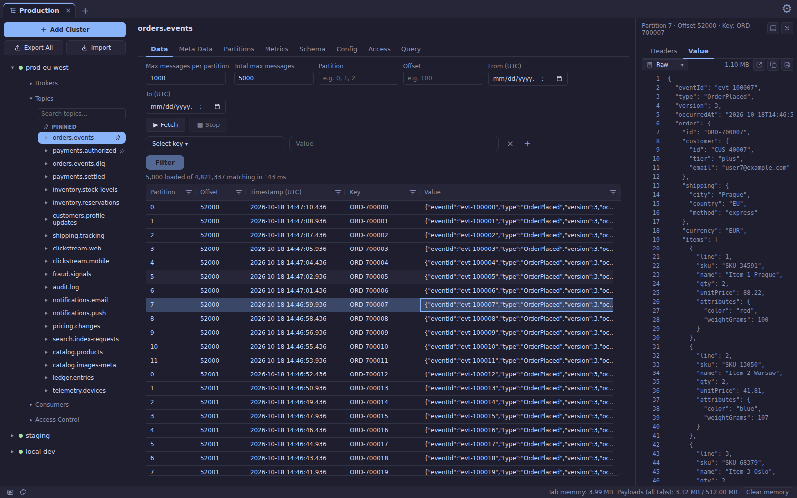
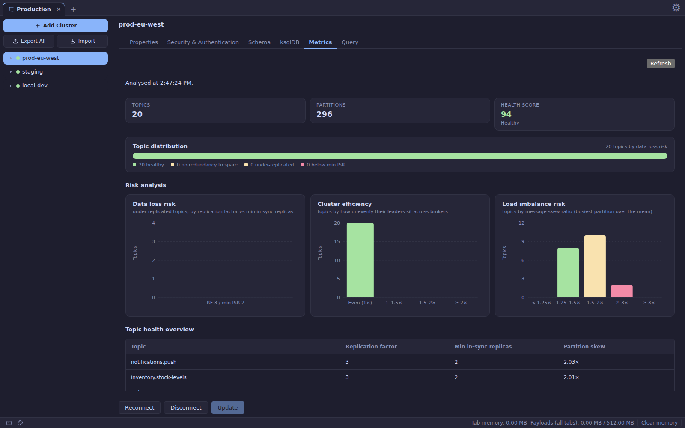
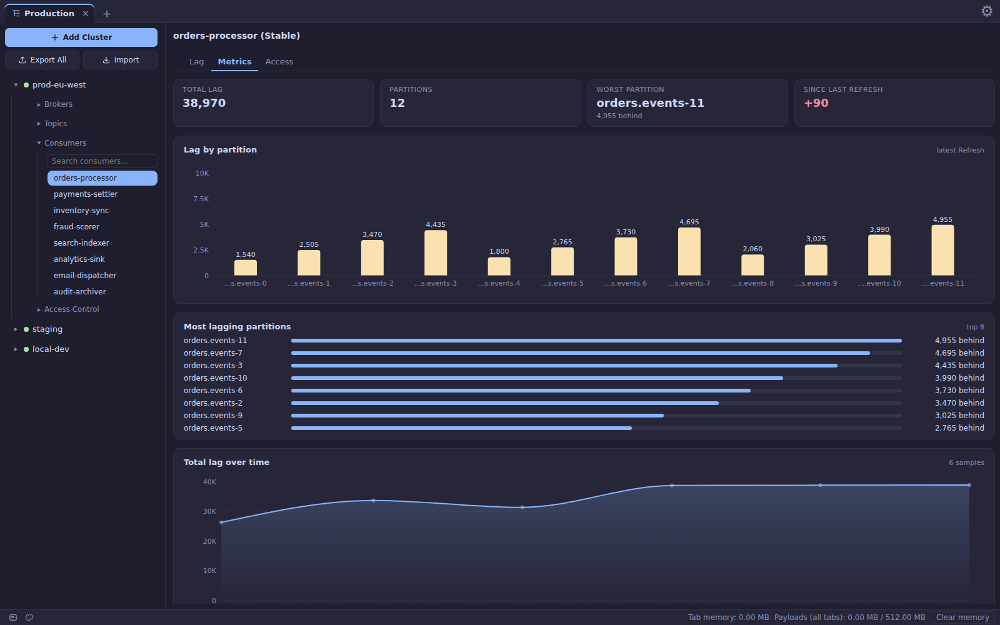
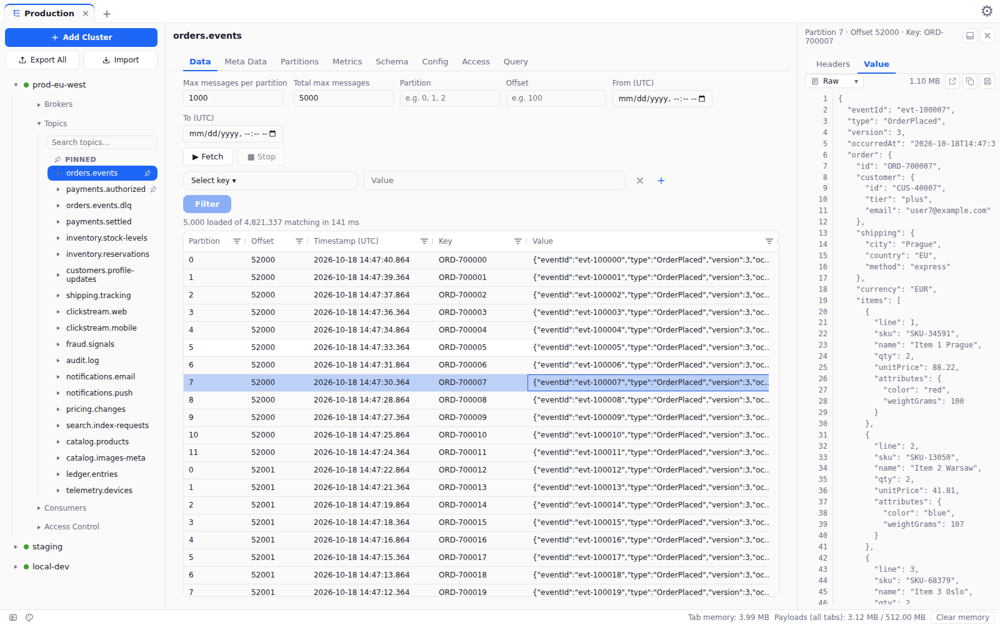

<h1 align="center">Salty</h1>

<p align="center">
  <b>The Kafka desktop client built for topics that are actually big.</b><br>
  Thousands of messages. Large payloads. A window that keeps scrolling.
</p>

<p align="center">
  <a href="https://salty-oxide.github.io/saltyapp/">Website</a> · <a href="../../releases">Download</a>
</p>

<p align="center">
  <a href="../../releases"></a>
  
  <a href="LICENSE"></a>
</p>

<p align="center">
  
</p>
<p align="center"><sub>A big topic loaded in the grid, with a large payload open beside it.</sub></p>

---

## Why Salty

Most Kafka GUIs are fine until you point them at a real topic: thousands of
records, plenty of them with large payloads, and suddenly the grid stutters,
the payload viewer freezes, and the app is holding half your RAM.

Salty is a Rust + Tauri app where **handling that volume is the design
constraint, not an afterthought**. Rows appear as they arrive, big payloads stay
out of the way until you open them, and the app stays responsive and within a
memory budget you control.

## Built for heavy topics

- **Thousands of messages, no waiting for the last one.** The grid fills as the fetch runs.
- **Large payloads stay smooth.** Opening one, scrolling it, or expanding a deeply nested document doesn't freeze the window.
- **Fast second look.** Messages you've already opened come back instantly.
- **Predictable memory.** A configurable limit, a live usage readout, and a one-click clear.
- **Quick to start, quick to browse.** Heavy parts load only when you need them, and cluster listings aren't re-fetched on every click.
- **Resilient connections.** A connection dropped by a firewall or NAT recovers instead of hanging your next click.

## Take a look

<table>
  <tr>
    <td width="50%" valign="top">
      
      <p><b>Cluster health at a glance.</b> Every topic scored for replication, leader spread and partition skew — with the data-loss risks surfaced first.</p>
    </td>
    <td width="50%" valign="top">
      
      <p><b>Consumer lag, explained.</b> Lag per partition, the worst offenders, and a lag-over-time line built from your own refreshes.</p>
    </td>
  </tr>
  <tr>
    <td colspan="2" valign="top">
      
      <p><b>Light or dark.</b> Multiple themes, a resizable multi-pane layout, and a payload panel you can dock beside or under the grid.</p>
    </td>
  </tr>
</table>

<sub>Screenshots show a seeded demo cluster (made-up topics and orders) rendered by the real frontend — no customer data, and the timings in them are not benchmarks.</sub>

## What you can do

**Explore**
- Browse brokers, topics, partitions and consumer groups in a tabbed tree/detail workspace. Pin topics and file topics or groups into folders.
- Multi-select topics or groups with Ctrl/Cmd or Shift and act on them together.
- Filter by partition, offset, time range or header, and search topics as you type.

**Read**
- A JSON tree viewer and raw view for payloads, with **Avro** (Confluent Schema Registry or a pasted schema) and **Protobuf** decoding built in. With no Protobuf schema you still get field numbers rather than an error.
- Save a payload exactly as rendered.

**Operate**
- Consumer group membership, assignment and lag, plus the ACLs that apply to a topic or group.
- Run **ksqlDB** statements and queries from a Query tab.
- Publish messages — **off by default** per connection, and always subject to the broker's own permissions.

**Connect**
- `PLAINTEXT`, `SSL`, `SASL_PLAINTEXT` and `SASL_SSL`, with PLAIN and SCRAM mechanisms.
- Export and import connections. Exports deliberately carry **no secrets** and never enable publishing.
- Credentials are kept in the app's local SQLite database, not the OS keychain.

## Tech stack

- **Backend:** Rust (Tauri v2), a Cargo workspace:
  - `backend/core` — shared domain types and the pure logic that needs no broker to test
  - `backend/kafka` — Kafka client on `rdkafka`/librdkafka
  - `backend/cache` — the payload cache
  - `backend/db` — SQLite storage (connections, tabs, pins and folders, saved schemas)
  - `backend/avro`, `backend/protobuf` — payload decoding
  - `backend/schema-registry` — Confluent Schema Registry client
  - `backend/ksql` — ksqlDB client
  - `src-tauri` — the application shell and thin command layer
- **Frontend:** React + TypeScript, Vite, Zustand, TanStack Query, AG Grid, Recharts, `react-window`
- **Storage:** SQLite

## Getting started

### Download

Prebuilt installers for macOS, Windows and Linux are on the [Releases](../../releases) page.

### Build from source

#### Prerequisites

- [Rust](https://www.rust-lang.org/tools/install) — the exact toolchain is pinned in `rust-toolchain.toml`, so `rustup` picks it up automatically
- [Node.js](https://nodejs.org/) **22 or newer** — not 20. The npm that ships with Node 20 crashes part-way through installing this project's dev dependencies (`Cannot read properties of null (reading 'edgesOut')`) and leaves `node_modules` half-populated, which then shows up as unrelated-looking "failed to resolve import" errors. CI builds on Node 24.
- [Tauri's platform prerequisites](https://v2.tauri.app/start/prerequisites/) for your OS (on Linux this includes `libwebkit2gtk-4.1-dev` and friends; on Windows, CMake + the MSVC Build Tools, since the Kafka client builds `librdkafka` from source)

#### Install dependencies

```bash
npm --prefix frontend install
```

The npm packages all live in `frontend/`, and the repo root is not an npm
workspace — so `npm install` at the root installs *nothing*, and `npm run dev`
then fails with `could not determine executable to run` (it cannot find the
Tauri CLI) or with a Vite import that will not resolve. Run the command above
once after cloning, and again whenever dependencies change; `package-lock.json`
is not committed, so nothing else will tell you they have.

#### Run in development

```bash
npm run dev
```

This runs `tauri dev`, which starts the Vite dev server for the frontend and launches the app shell with hot reload.

#### Build a production bundle

```bash
npm run build
```

This produces platform-native installers (`.dmg` on macOS, `.exe`/`.msi` on Windows, `.deb`/`.AppImage` on Linux) under `src-tauri/target/release/bundle/`.

#### Generate the app files manually (as CI does)

The release workflow (`.github/workflows/release.yml`) runs these steps on each platform. To reproduce a release build by hand, run them from the repo root:

```bash
# 1. Frontend dependencies and build (Tauri embeds the result into the binary)
npm install --prefix frontend
npm run build --prefix frontend

# 2. Force librdkafka to rebuild, so its codec config is never served from cache
cargo clean -p rdkafka-sys --release
cargo clean -p rdkafka-sys

# 3. Build the app binary
cargo build --release --manifest-path src-tauri/Cargo.toml

# 4. Verify the binary itself decodes every codec (use salty-app.exe on Windows)
./target/release/salty-app --librdkafka-features /tmp/librdkafka-features.txt
cat /tmp/librdkafka-features.txt

# 5. Verify librdkafka's own feature report
cargo test --release -p salty-kafka build_info -- --nocapture

# 6. Bundle the installers
npm run build
```

Step 6 is the manual stand-in for CI's `tauri-apps/tauri-action`. The installers are written under `target/release/bundle/`.

The version in the installer's file name comes from `version` in `src-tauri/tauri.conf.json`. CI also tags the release `app-v<version>` from it and skips the build if that tag already exists, so bump the version there to publish a new release. On Windows, CI first installs zstd with `vcpkg install zstd:x64-windows-static` and sets `CMAKE_PREFIX_PATH` to `<vcpkg root>\installed\x64-windows-static`; do the same if the librdkafka build can't find zstd.

#### Run tests

```bash
# Frontend
npm --prefix frontend test

# Backend
cargo test
```

Tests that need a real broker skip themselves unless `SALTY_E2E_BOOTSTRAP` is set; `scripts/e2e-fixtures.sh` brings one up.

## License

Licensed under the [Apache License 2.0](LICENSE).
